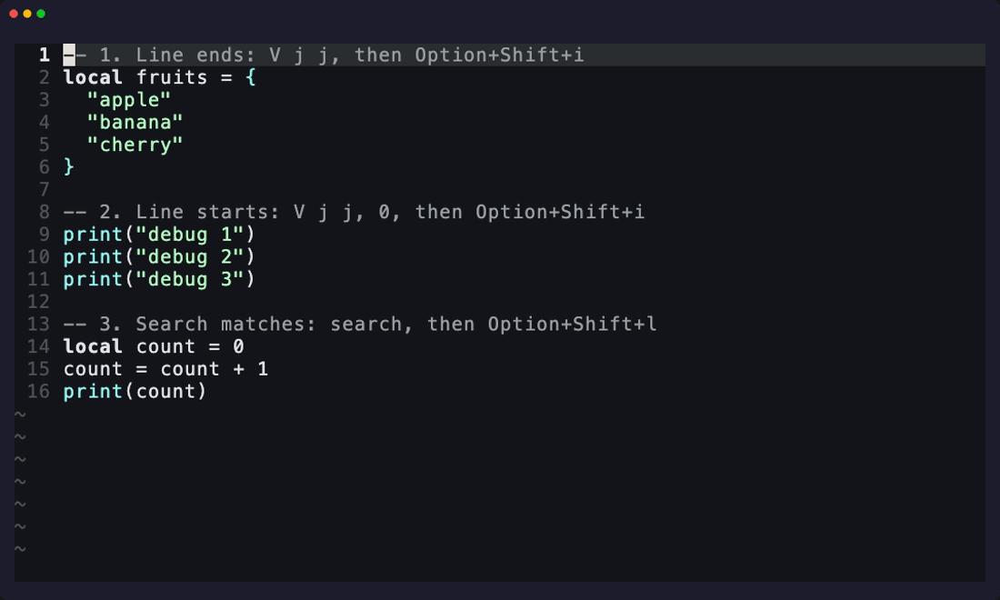

<div align="center">

# nvim-multi-cursors-vsc

**VSCode-style multi-cursor editing for Neovim.**

Select lines, press <kbd>⌥ Option</kbd>+<kbd>⇧ Shift</kbd>+<kbd>I</kbd>, type once, edit everywhere.

[](https://github.com/noppGithub/nvim-multi-cursors-vsc/actions/workflows/ci.yml)


[](LICENSE)



<sub>Prefer a video? <a href="demo/demo.mp4">demo/demo.mp4</a></sub>

</div>

---

## Why

If your fingers learned multi-cursor editing in VSCode, you already know this plugin.
The same <kbd>Alt</kbd>+<kbd>Shift</kbd>+<kbd>I</kbd> puts a cursor on every selected line, everything you type shows up at every cursor live, and <kbd>Esc</kbd> brings you back to a single cursor.
It stays out of your way otherwise: no new modes to learn, no dependencies, and one `u` undoes the whole edit.

## Features

| | What you press | What happens |
| --- | --- | --- |
| 📍 | `V` + <kbd>⌥⇧I</kbd> | A cursor at the **end** of every selected line |
| ⏮️ | `V` + `0` + <kbd>⌥⇧I</kbd> | A cursor at the **start** of every selected line (`^` for the first non-blank) |
| 🧱 | `Ctrl-v` + <kbd>⌥⇧I</kbd> | A cursor per line at the **block column** |
| 🔎 | `/word` + <kbd>⌥⇧L</kbd> | A cursor **after every match** of your search |
| ✍️ | type anything | Mirrored live: text, <kbd>Enter</kbd>, <kbd>Backspace</kbd>, <kbd>Delete</kbd>, `Ctrl-w`, `Ctrl-u`, completion, auto-pairs, any language |
| ↔️ | <kbd>←</kbd> <kbd>→</kbd> <kbd>Home</kbd> <kbd>End</kbd> | Every cursor moves together, <kbd>Home</kbd> / <kbd>End</kbd> per line like VSCode |
| ↩️ | `u` | Undoes the whole multi-cursor edit at once |

> [!NOTE]
> <kbd>⌥⇧I</kbd> means <kbd>Option</kbd>+<kbd>Shift</kbd>+<kbd>I</kbd> on macOS and <kbd>Alt</kbd>+<kbd>Shift</kbd>+<kbd>I</kbd> on Windows / Linux.
> On macOS your terminal has to send <kbd>Option</kbd> as <kbd>Alt</kbd>, see [macOS terminal setup](#-macos-terminal-setup).

## 📦 Installation

Requires **Neovim 0.10+**.

<details open>
<summary><b>lazy.nvim</b></summary>

```lua
{
  "noppGithub/nvim-multi-cursors-vsc",
  opts = {},
}
```

</details>

<details>
<summary><b>vim-plug</b></summary>

```vim
call plug#begin()
Plug 'noppGithub/nvim-multi-cursors-vsc'
call plug#end()

" Guarded so Neovim starts cleanly before :PlugInstall has run.
lua << EOF
local ok, multi_cursors = pcall(require, "multi_cursors_vsc")
if ok then
  multi_cursors.setup()
end
EOF
```

Then run `:PlugInstall` and restart Neovim.

</details>

<details>
<summary><b>Built-in packages</b> (<code>:h packages</code>)</summary>

```sh
git clone https://github.com/noppGithub/nvim-multi-cursors-vsc \
  ~/.local/share/nvim/site/pack/plugins/start/nvim-multi-cursors-vsc
```

Then add `require("multi_cursors_vsc").setup()` to your `init.lua`.

</details>

## 🚀 Quick start

1. Select a few lines with `V` and `j`.
2. Press <kbd>⌥⇧I</kbd>: a cursor appears at the end of every line.
3. Type.
4. Press <kbd>Esc</kbd> (or your own escape mapping, such as `jj`).

That's it.
The rest of this page shows each feature with a before / after example.
In the examples, `│` is the real cursor and `▌` are the extra cursors.

## 📖 Usage

### 📍 Add text at the end of lines

Select the lines, press <kbd>⌥⇧I</kbd>, type.

```text
Keys:    V j j  ⌥⇧I  ,  Esc
```

```lua
-- before                         -- while typing             -- after
local fruits = {                  local fruits = {            local fruits = {
  "apple"                           "apple",▌                   "apple",
  "banana"                          "banana",▌                  "banana",
  "cherry"                          "cherry",│                  "cherry",
}                                 }                           }
```

Works with `v`, `V`, `vip`, `vap`, counts like `V10j`, or `:[range]MultiCursorsLineEnds`.

### ⏮️ Add text at the start of lines

Select the lines, press `0`, then <kbd>⌥⇧I</kbd>.
Press `^` instead of `0` to start at the first non-blank character, which keeps the indentation of indented code.

```text
Keys:    V j j  0  ⌥⇧I  -- ␣  Esc
```

```lua
-- before                         -- after
print("debug 1")                  -- print("debug 1")
print("debug 2")                  -- print("debug 2")
print("debug 3")                  -- print("debug 3")
```

```text
Keys:    v i p  ^  ⌥⇧I  - [ ] ␣  Esc
```

```markdown
<!-- before -->                   <!-- after -->
  milk                              - [ ] milk
  eggs                              - [ ] eggs
  bread                             - [ ] bread
```

The indentation stays in front of the new text.

> [!TIP]
> Only the key pressed **right before** <kbd>⌥⇧I</kbd> counts.
> A selection that merely happens to start at column 0 still gets the cursors at the line ends.

### 🔎 Edit every search match

Search with `/` (or `*` on a word), then press <kbd>⌥⇧L</kbd>, the terminal-friendly version of VSCode's <kbd>Cmd</kbd>/<kbd>Ctrl</kbd>+<kbd>Shift</kbd>+<kbd>L</kbd> "Select All Occurrences".
Every match gets a cursor right after it, so typing straight away adds to the matches and can never wipe them by accident.

```text
Keys:    / c o u n t ⏎  ⌥⇧L  e r  Esc
```

```lua
-- before                         -- while typing                  -- after
local count = 0                   local counter│ = 0               local counter = 0
count = count + 1                 counter▌ = counter▌ + 1          counter = counter + 1
print(count)                      print(counter▌)                  print(counter)
```

**Replace the matches instead:** after <kbd>⌥⇧L</kbd>, press `Ctrl-w` (deletes the word before every cursor) and type the new name:

```text
Keys:    * ⌥⇧L  Ctrl-w  t o t a l  Esc      (with the cursor on "count")
```

```lua
-- before                         -- after
local count = 0                   local total = 0
count = count + 1                 total = total + 1
print(count)                      print(total)
```

Or turn on `select_matches = true` to get VSCode's exact behaviour: the matches are shown selected, typing replaces them, <kbd>Backspace</kbd> deletes them, <kbd>←</kbd> / <kbd>→</kbd> go to the start / end of every match.

More about matches:

- **Only part of the file:** select lines first (`V` + `j` / `vip` / ...), then press <kbd>⌥⇧L</kbd> to use only the matches in the selection.
- **Case:** `'ignorecase'` and `'smartcase'` work exactly like they do for `n`.
- **Regex power:** `/^` + <kbd>⌥⇧L</kbd> puts a cursor at the start of every line in the buffer, `/$` + <kbd>⌥⇧L</kbd> one at the end of every line.
- **Command:** `:[range]MultiCursorsMatches` (default: the whole buffer).

### 🧱 Column editing with visual block

In visual-block mode (`Ctrl-v`), <kbd>⌥⇧I</kbd> puts a cursor on every line at the left edge of the block.
Lines too short to reach the column are skipped, and after `$` the cursors go to the line ends.

```text
Keys:    Ctrl-v j j  ⌥⇧I  M Y _  Esc      (cursor on "A")
```

```js
// before                         // after
const A = 1                       const MY_A = 1
const B = 2                       const MY_B = 2
const C = 3                       const MY_C = 3
```

### ↔️ Moving the cursors

While typing, cursor keys move every cursor together:

| Key | Every cursor... |
| --- | --- |
| <kbd>←</kbd> / <kbd>→</kbd> | moves one character |
| <kbd>Home</kbd> | jumps to the first non-blank of its own line, press again for column 0 |
| <kbd>End</kbd> | jumps to the end of its own line |

```text
Keys:    V j  ⌥⇧I  )  Home  (  Esc
```

```lua
-- before                         -- after
a + b                             (a + b)
x * y                             (x * y)
```

Moving to another line (<kbd>↑</kbd>, <kbd>↓</kbd>, a mouse click, ...) ends the multi-cursor session and keeps everything typed so far.

### ✍️ What gets mirrored

Everything you do in insert mode is replayed at every cursor:

- typed text in any language and script, multibyte included (`สวัสดี`, `日本語`, `é`)
- <kbd>Enter</kbd> (splits every line), <kbd>Backspace</kbd> and <kbd>Delete</kbd> (also across line breaks)
- `Ctrl-w` (delete word) and `Ctrl-u` (delete line)
- completion (`Ctrl-n`, `Ctrl-p`, completion plugins) and auto-pair mappings

When you are done, press <kbd>Esc</kbd> (or any mapping that leaves insert mode), and a single `u` undoes the whole edit.

## ⌨️ Cheat sheet

| Mode | Keys | Action |
| --- | --- | --- |
| Visual | <kbd>⌥⇧I</kbd> | Cursors at the end of the selected lines |
| Visual | `0` <kbd>⌥⇧I</kbd> | Cursors at the start of the selected lines |
| Visual | `^` <kbd>⌥⇧I</kbd> | Cursors at the first non-blank of the selected lines |
| Visual block | <kbd>⌥⇧I</kbd> | Cursors at the block column (`$`: line ends) |
| Normal | <kbd>⌥⇧L</kbd> | Cursors after every match of the last search |
| Visual | <kbd>⌥⇧L</kbd> | Cursors after the matches in the selected lines |
| Insert | <kbd>←</kbd> <kbd>→</kbd> <kbd>Home</kbd> <kbd>End</kbd> | Move every cursor |
| Insert | <kbd>Esc</kbd> | Back to one cursor |
| Normal | `u` | Undo the whole multi-cursor edit |

### Commands

| Command | Description |
| --- | --- |
| `:[range]MultiCursorsLineEnds` | Add a cursor at the end of every line in `[range]` and start typing. |
| `:[range]MultiCursorsMatches` | Add a cursor after every match of the last search in `[range]` (default: whole buffer). |
| `:MultiCursorsStop` | Stop the active session, the extra cursors disappear and the text stays. |

## ⚙️ Configuration

Defaults, pass any subset to `setup()` (or to `opts` with lazy.nvim):

```lua
require("multi_cursors_vsc").setup({
  keymaps = {
    -- Visual mode: a cursor at the end of every selected line.
    line_ends = "<M-I>",
    -- Normal / visual mode: a cursor after every match of the last search.
    matches = "<M-L>",
  },
  -- Select the matches so typing replaces them, instead of putting the
  -- cursors right after them.
  select_matches = false,
  -- Highlight group for the extra cursors.
  hl_group = "MultiCursorsVscCursor",
  -- Highlight group for the selected matches (select_matches = true).
  selection_hl_group = "MultiCursorsVscSelection",
})
```

**Your own keys:** set a key to `false` and map the Lua functions yourself.

```lua
local multi_cursors = require("multi_cursors_vsc")
multi_cursors.setup({ keymaps = { line_ends = false, matches = false } })

vim.keymap.set("x", "<leader>m", multi_cursors.add_cursors_from_visual)
vim.keymap.set("n", "<leader>M", function()
  multi_cursors.add_cursors_to_matches()
end)
```

**Colors:** the extra cursors use `MultiCursorsVscCursor` (reverse video by default) and selected matches use `MultiCursorsVscSelection` (linked to `Visual`).

```lua
vim.api.nvim_set_hl(0, "MultiCursorsVscCursor", { bg = "#f9e2af", fg = "#1e1e2e" })
```

**Lua API**

| Function | Description |
| --- | --- |
| `add_cursors_from_visual()` | What <kbd>⌥⇧I</kbd> does, call it from a visual-mode mapping. |
| `add_cursors_to_line_ends(first, last, lnum)` | Cursors at the end of lines `first..last`, typing starts on `lnum`. |
| `add_cursors_to_line_starts(first, last, lnum, first_non_blank)` | Cursors at column 0 (or the first non-blank) of lines `first..last`. |
| `add_cursors_to_matches(first?, last?)` | Cursors after every match of the last search, optionally in lines `first..last`. |
| `stop()` / `is_active()` | Stop the session / check whether one is active. |

Full reference: `:help multi_cursors_vsc`.

## 🍎 macOS terminal setup

macOS turns <kbd>Option</kbd>+<kbd>Shift</kbd>+<kbd>I</kbd> into the character `ˆ` before Neovim sees it.
Tell your terminal to send <kbd>Option</kbd> as <kbd>Alt</kbd>:

| Terminal | Setting |
| --- | --- |
| WezTerm | Works out of the box with the **left** <kbd>Option</kbd> key. |
| iTerm2 | Settings → Profiles → Keys → Left Option key: `Esc+` |
| kitty | `macos_option_as_alt yes` |
| Ghostty | `macos-option-as-alt = true` |
| Alacritty | `[window]` `option_as_alt = "Both"` |
| Terminal.app | Settings → Profiles → Keyboard → "Use Option as Meta key" |
| Neovide | `vim.g.neovide_input_macos_option_key_is_meta = "only_left"` |

To check, press `Ctrl-v` in insert mode, then <kbd>Option</kbd>+<kbd>Shift</kbd>+<kbd>I</kbd>.
You should get an escape followed by `I` (`^[I`), not `ˆ`.

## ❓ FAQ

<details>
<summary><b>Pressing <kbd>⌥⇧I</kbd> types <code>ˆ</code> or does nothing</b></summary>

Your terminal sends <kbd>Option</kbd> as a character modifier, see [macOS terminal setup](#-macos-terminal-setup).
In WezTerm, use the **left** <kbd>Option</kbd> key, the right one types special characters by default.

</details>

<details>
<summary><b>The cursors went away when I pressed <kbd>↑</kbd> / <kbd>↓</kbd></b></summary>

Moving to another line ends the session on purpose, everything typed so far stays.
Select again and press <kbd>⌥⇧I</kbd> to continue.

</details>

<details>
<summary><b>Some search matches got no cursor</b></summary>

For patterns that match zero characters (like `\<`), only the first match of each line gets a cursor.
`^` and every pattern that matches actual text get a cursor on every match.

</details>

<details>
<summary><b>Can I keep my <code>jj</code> escape mapping?</b></summary>

Yes, any mapping that leaves insert mode finishes the multi-cursor edit, exactly like <kbd>Esc</kbd>.

</details>

## 🛠️ Development

```sh
make test   # end-to-end tests, each case drives a fresh Neovim with real key presses
make lint   # stylua --check
```

The demo is recorded with [VHS](https://github.com/charmbracelet/vhs): `vhs demo/demo.tape`.

## 📄 License

[MIT](LICENSE)
